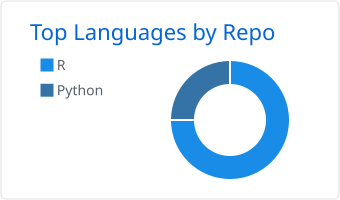
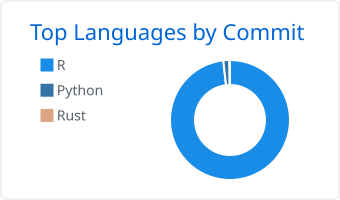

<div align="center">


[](https://www.linkedin.com/in/sebalucas/)
[](mailto:sebalucas@gmail.com)
[](https://cran.r-project.org/web/checks/check_results_sebalucas_at_gmail.com.html)
[](https://sebollin.r-universe.dev/)
[](https://orcid.org/0009-0009-9068-0276)

🇺🇾

[](README.en.md)

</div>

---

## 👋 Quién soy

Empecé adentro de un aula y hoy, **18 años después**, trabajo adentro de los
datos —los de las transferencias que decide el Estado, los de las compras de una
universidad, y los de cualquier problema que se deje modelar—. La pregunta es
siempre la misma: qué dice este dato, y qué no puede decir. Del aula no me fui
del todo: sigo coordinando talleres en un liceo público.

- 🏛️ **Analista de datos** en la **Dirección Nacional de Transferencias y Análisis de Datos ([DINTAD](https://www.gub.uy/ministerio-desarrollo-social/))** del **MIDES**, como consultor de **[UNFPA](https://uruguay.unfpa.org/)**: gestión y análisis de los programas de transferencias monetarias a hogares en situación de vulnerabilidad socioeconómica.
- 📊 **Analista de datos** en el **[SeCIU](https://www.seciu.edu.uy/)** de la Universidad de la República: tableros institucionales en **R** y **Shiny**.
- 🎓 **Especialista en Ciencia de Datos**; ahora curso la **Maestría** (CPAP–FIng, UdelaR).
- 🌳 Cultivo bonsáis y mantengo el front-end de la tienda **[komorebibonsai.uy](https://komorebibonsai.uy)**, que es donde escribo el código que no lleva estadística.

**Auditable antes que automático**: muestro alcance, evidencia e incertidumbre
antes que una respuesta cómoda.

> **In English** — A Uruguayan data scientist who started out in a classroom 18
> years ago. I analyse cash-transfer data at the Ministry of Social Development,
> as a UNFPA consultant, and build dashboards at Universidad de la República.
> Two of my R packages are on CRAN: `lupa`, for auditable data quality, and
> `bigbang`, for meta-packages that work offline. I co-author `geouy`, archived
> in 2025 and now back under CRAN review, and I have proposed fixes to the
> Python library `ftfy`. → **[Full profile in English](README.en.md)**

---

## 📦 Paquetes de R

<table>
<tr>
<td colspan="2" valign="top">

### [lupa](https://github.com/sebollin/lupa) <a href="https://sebollin.github.io/lupa/"></a>

**En CRAN.** Calidad de datos de punta a punta, y **auditable**: cada resultado
declara su alcance, su evidencia y lo que no pudo medir. El dato original nunca
cambia en silencio.

- 🔎 **Perfilar** — lo que `summary()` no ve: faltantes disfrazados de `"S/D"` o de `-99`, fechas en formatos mezclados, claves y relaciones que nadie declaró. Con las filas donde está cada problema.
- 📏 **Medir** — con un marco de calidad propio o con los que trae implementados: el de gobierno digital de AGESIC, el de aseguramiento de la calidad estadística de Naciones Unidas en su adaptación de la CEPAL, e ISO/IEC 25012.
- 🧹 **Limpiar** — una copia, con un plan editable y registro de auditoría.
- 📈 **Seguir** — comparación de entregas, histórico de calidad y detección de deriva, en un informe HTML autocontenido.
- 🗄️ **Escalar** — perfila dentro de la base, en seis motores SQL, y busca duplicados aproximados con MinHash/LSH.

```r
install.packages("lupa")
```

[](https://cran.r-project.org/package=lupa)
[](https://cran.r-project.org/package=lupa)
[](https://cran.r-project.org/package=lupa)
[](https://cran.r-project.org/package=lupa)
[](https://github.com/sebollin/lupa/actions/workflows/R-CMD-check.yaml)
[](https://github.com/sebollin/lupa/actions/workflows/motores.yaml)
[](https://www.repostatus.org/#active)
[](https://sebollin.github.io/lupa/)
[](https://doi.org/10.5281/zenodo.24117753)

</td>
</tr>
<tr>
<td width="50%" valign="top">

### [bigbang](https://github.com/sebollin/bigbang) <a href="https://sebollin.github.io/bigbang/"></a>

**En CRAN.** Arma metapaquetes estilo *tidyverse* a partir de paquetes locales
(`.tar.gz` / `.zip`). Pensado para equipos detrás de un firewall
institucional: funciona sin internet.

```r
install.packages("bigbang")
```

[](https://cran.r-project.org/package=bigbang)
[](https://cran.r-project.org/package=bigbang)
[](https://cran.r-project.org/package=bigbang)
[](https://github.com/sebollin/sebollin/blob/main/.github/scripts/badges.R)
[](https://cran.r-project.org/package=bigbang)
[](https://github.com/sebollin/bigbang/actions/workflows/R-CMD-check.yaml)
[](https://app.codecov.io/gh/sebollin/bigbang)
[](https://www.repostatus.org/#active)
[](https://sebollin.github.io/bigbang/)
[](https://doi.org/10.5281/zenodo.23192961)

</td>
<td width="50%" valign="top">

### [geouy](https://github.com/Richard-Detomasi/geouy) · coautor <a href="https://github.com/Richard-Detomasi/geouy"></a>

Datos geográficos oficiales de Uruguay —capas del INE, la IDE, el MIDES, el MTOP
y Ambiente, entre otras— listos para usar en R como objetos `sf`. Lo creó y lo
mantiene [Richard Detomasi](https://github.com/Richard-Detomasi). Estuvo cinco
años en CRAN hasta que lo archivaron en 2025. Lo dejamos otra vez en
condiciones, y la versión 0.3.0 ya está en revisión en CRAN; mientras tanto, se
instala desde GitHub:

```r
pak::pak("Richard-Detomasi/geouy")
```

[](https://cran.r-project.org/package=geouy)
[](https://cran.r-project.org/package=geouy)
[](https://github.com/Richard-Detomasi/geouy/actions/workflows/R-CMD-check.yaml)
[](https://app.codecov.io/gh/Richard-Detomasi/geouy?branch=master)
[](https://www.repostatus.org/#active)
[](https://cran.r-project.org/web/views/Spatial.html)
[](https://doi.org/10.5281/zenodo.3610246)

</td>
</tr>
</table>

`bigbang` y `lupa` se instalan también desde **[sebollin.r-universe.dev](https://sebollin.r-universe.dev/)**.
`bigbang`, `lupa` y `geouy` figuran en el [catálogo de paquetes de R latinoamericanos](https://github.com/Estacion-R/asombrosos-paquetes-r-latinoamerica)
de Estación R, y los hexágonos de `bigbang` y `geouy`, en la [galería de hexSticker](https://github.com/GuangchuangYu/hexSticker#stickers-for-software-packages).

---

## 🏗️ Lo que desarrollé

- 📊 **Monitor de compras de la UdelaR** *(SeCIU)* — cerca de **100.000 compras** en un tablero de [Shiny](https://shiny.posit.co/) con múltiples visualizaciones y filtros cruzados, CSS propio incluido.
- 🏛️ **[tus-ipm-microsimulacion](https://github.com/sebollin/tus-ipm-microsimulacion)** — microsimulación del efecto de aumentos de la Tarjeta Uruguay Social sobre la **pobreza multidimensional** (ECH 2025): resultados agregados, figuras reproducibles y la arquitectura metodológica.
- 🧰 **[lupa](https://github.com/sebollin/lupa)** y **[bigbang](https://github.com/sebollin/bigbang)** — los dos paquetes míos de acá arriba; los escribí porque me hacían falta y no existían.
- 🗺️ **CARTOGRAFÍA URGENTE** — relevamiento y análisis de la distribución geográfica de las propuestas educativas de Montevideo para niñas, niños y adolescentes.

Y fuera del horario: optimización y modelos de pronóstico para problemas que no
le importan a nadie más que a mí. Todavía privados.

---

## 🤝 Aportes a otros proyectos

### 🔤 [ftfy](https://github.com/rspeer/python-ftfy) — reparación de mojibake

Tres arreglos propuestos a la biblioteca de referencia para reparar mojibake, de
[Robyn Speer](https://github.com/rspeer):
[detección y reparación de KOI8-R](https://github.com/rspeer/python-ftfy/pull/234),
[mojibake de Windows-1252 en los símbolos del bloque U+2000](https://github.com/rspeer/python-ftfy/pull/235)
y [un ancla de expresión regular que se come el salto de línea final en el codec CESU-8](https://github.com/rspeer/python-ftfy/pull/237).

---

## 🛠️ Con qué trabajo

<div align="center">

**Lenguajes**


**Entornos y versionado**


**Datos, modelos y visualización**


**Bases de datos**


**Sistemas y publicación**


**Información geográfica**


</div>

---

## 🎓 Formación

<table>
<tr><td><strong>Maestría en Ciencia de Datos</strong> <em>(en curso)</em></td><td>CPAP – FIng, UdelaR</td></tr>
<tr><td><strong>Especialista en Ciencia de Datos</strong></td><td>CPAP – FIng, UdelaR</td></tr>
<tr><td><strong>Licenciado en Educación</strong></td><td>Universidad Católica del Uruguay</td></tr>
<tr><td><strong>Sistemas de Información Geográfica e Innovación Ambiental</strong></td><td>Universidad Católica del Uruguay</td></tr>
<tr><td><strong>Técnico en Educación para el Tiempo Libre y la Recreación</strong></td><td>Universidad Católica del Uruguay</td></tr>
</table>

---

## ✍️ Publicaciones, ponencias y reconocimientos

- **[{DADverse}. Simplificando el procesamiento de datos para políticas públicas enfocadas en población vulnerable en ambientes de uso restringido](https://github.com/LatinR/presentaciones-LatinR2023/blob/main/papers/slides/DADverse.pdf)** — Lucas, S.; Detomasi, R. *LatinR 2023*.
- **La Siembra. El legado de Aulas Comunitarias: un aporte a la educación uruguaya** — coautor del cap. 1.3.2. OBSUR, 2020.
- **[El aula en movimiento: aportes metodológicos desde la Educación No Formal](https://www.gub.uy/ministerio-educacion-cultura/sites/ministerio-educacion-cultura/files/documentos/publicaciones/Revista_Enfoques_5.pdf)** — Catalurda, R.; Lucas, S.; González, W. *Enfoques, Revista de Educación No Formal*, MEC, v. 5, 2014.
- **Talleres en el liceo… ¿para qué?** — Lucas, S.; Verdún, N. Ponencia en la Cátedra «Alicia Goyena» (CES–ANEP), 2016.
- 🏆 **Proyecto «Todo Suma»** — creador e impulsor. Ganador del *Concurso sobre Proyectos de Convivencia de los Centros Educativos*, Programa Pelota al Medio a la Esperanza.

---

## 📊 GitHub

<div align="center">

<picture>
  <source media="(prefers-color-scheme: dark)" srcset="assets/tarjetas/1-repos-per-language.github_dark.svg" />
  
</picture>
<picture>
  <source media="(prefers-color-scheme: dark)" srcset="assets/tarjetas/2-most-commit-language.github_dark.svg" />
  
</picture>

</div>

---

<div align="center">

**¿Trabajamos juntos?** — [LinkedIn](https://www.linkedin.com/in/sebalucas/) · [sebalucas@gmail.com](mailto:sebalucas@gmail.com)

<sub>Ciudad de la Costa, Canelones · Uruguay 🇺🇾</sub>


</div>
